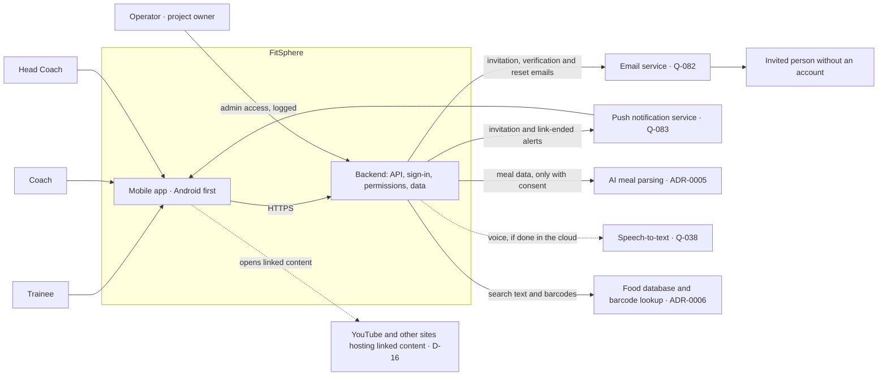

# System Context

- Status: Draft
- Owner: Project owner (D-01)
- Last updated: 2026-10-27

What FitSphere is made of at the highest level, who uses it, which outside systems it depends
on, and where data crosses a trust boundary. Components are **logical**. The mobile app uses
React Native with Expo (ADR-0001, Accepted — D-12); no backend technology is chosen yet
(ADR-0002 and ADR-0003 are Proposed; ADR-0004 to ADR-0007 are Missing). Detailed flows are in
[`flow.md`](../../flow.md); threats and the permission matrix are in
[`data-and-threat-model.md`](../security/data-and-threat-model.md). D- numbers refer to
[`owner-decisions-2026-10-27.md`](../product/owner-decisions-2026-10-27.md).

## System boundary
FitSphere consists of:
- **Mobile app** — Android first, iOS later (D-10), with an encrypted on-device store for
  offline logging (REQ-NFR-004).
- **Backend** — API, sign-in, permission checks (invariant 1), domain services, the consent
  check before any AI call (invariant 3), database and media storage.

Everything else on this page is outside the boundary.

## People
| Actor | Uses FitSphere to | Reference |
|---|---|---|
| Trainee (Personal Training User) | Log food, body metrics and workouts; answer invitations and Head Coach permission requests | REQ-ROLE-001, REQ-ROLE-013 |
| Coach | Invite trainees; set their targets and plans | REQ-ROLE-005, REQ-ROLE-006 |
| Head Coach | Invite coaches; see counts per coach; see the data of, and set plans and targets for, trainees who allow it | REQ-ROLE-003, REQ-ROLE-004 |
| Invited person without an account | Receive an invitation email and sign up | REQ-ROLE-008 |
| Operator | Run FitSphere. Phase 1: the project owner only, no support staff; every admin access to user data is logged in the backend database and reviewed monthly | REQ-NFR-005, D-13, D-14, R-003 |
| Platform Admin *(future scope)* | A fourth role for the business owner, with the rights needed to run FitSphere as a business; not designed | D-13, Q-086 |

## Diagram

## External systems
| System | Why FitSphere uses it | Data sent to it | Sensitivity | Decision |
|---|---|---|---|---|
| Email service | Invitation emails with a sign-up link (REQ-ROLE-008); verification and password-reset emails (REQ-ACC-010) | Recipient address, email text, sign-up or reset link | Reveals that someone was invited to, or uses, a health app | Q-082, ADR-0002; SPF, DKIM and DMARC on the sender domain (D-13) |
| Push notification service | Alerts for in-app invitations (REQ-ROLE-009) and "no longer linked" messages (REQ-ROLE-014, D-14) | Device token, notification text | Notification text passes through Google or Apple (below) | Q-083, ADR-0002; Expo push support checked in the first slice (ADR-0001, D-13) |
| AI meal-parsing provider | Turn meal text, photos, voice and labels into food items (REQ-LOG-009) | Meal text, photos, voice, labels — only with consent (C-004) | Sensitive | ADR-0005, Q-049 |
| Speech-to-text | Voice meal entry (REQ-LOG-005), if done in the cloud | Voice recordings, deleted once transcribed (D-16) | Sensitive | Q-038 |
| Food database and barcode lookup | Search and barcode logging without AI (REQ-LOG-007, C-005) | Search text, barcode numbers | Low on its own | Q-039, ADR-0006 |
| YouTube and other sites hosting linked content | Coaches' exercise how-to videos (REQ-TRN-001) and users' own content added as a link instead of an upload (REQ-LOG-010) | Nothing from FitSphere's servers; FitSphere stores only the link. When someone opens it, their phone requests the content from that site | The site learns who opened the content and when; FitSphere cannot delete the content or revoke access to it (R-004) | D-16, T-09, Q-049 |

Push services on Android normally deliver through Google's Firebase Cloud Messaging, and on iOS
through Apple Push Notification service, so notification text also passes through Google or
Apple. Keeping health data out of notification text is proposed, not decided.

## Delivery (not used at runtime)
| System | Purpose | Reference |
|---|---|---|
| Google Play | Android release in phase 1 | C-008, D-10 |
| Apple App Store and TestFlight | iOS release, deferred until an iPhone is available | C-008, D-10, R-001 |
| EAS Build | Cloud builds, including the iOS compile check | ADR-0001 (Accepted, D-12) |

## Trust boundaries
1. **Phone ↔ backend:** everything from the phone is untrusted. All permission checks run on the
   server, including for changes queued offline when they sync (invariant 1, T-02).
2. **Backend ↔ each external service:** data leaves FitSphere's control. AI calls only with
   recorded consent (invariant 3); data processing terms needed (Q-049).
3. **Email:** once sent, an invitation email can be forwarded or kept, and look-alike emails
   can be faked. Invitation links work once and expire after 7 days, as do in-app invitations;
   the sender domain uses SPF, DKIM and DMARC (T-04, T-05, D-13, D-14).
4. **Push:** notification text passes through the platform push service.
5. **The phone itself:** health data stored for offline use is encrypted, invisibly to the user
   (T-03, D-14). The server is the permanent record; the phone holds a copy. When a link ends,
   the former coach's or Head Coach's app deletes that trainee's data on its next sync, and after
   30 days without a sync it clears drafts and other people's data — never the user's own
   unsynced entries (T-06, REQ-NFR-004, D-13, D-14).
6. **Operator ↔ user data:** admin access does not come from a link, so every access is logged
   and the log is reviewed monthly; the operator reviews their own access (REQ-NFR-005, T-07,
   R-003). The owner uses two-factor sign-in on the hosting dashboards and never browses user
   data there (D-16).
7. **Linked content on other sites:** content a user adds as a link stays on that site. When a
   link between people ends, FitSphere hides the link from the former coach or Head Coach but
   cannot revoke access to the content (R-004, T-09, D-16).

## Not in phase 1
- Health-platform sync (Apple Health, Google Health Connect) — proposed non-goal (Q-003, Q-015).
- SMS or WhatsApp invitations — future scope (D-11).
- Platform Admin role — future scope (D-13, Q-086).

## Open items
- Email service and sender domain (Q-082); push service (Q-083); speech-to-text (Q-038); food
  data source (Q-039); hosting and data residency (ADR-0002, ADR-0003, Q-049).
- Legal to confirm the 1-year retention of the admin access log (Q-049); the operator reviewing
  their own access is an accepted risk (R-003).
