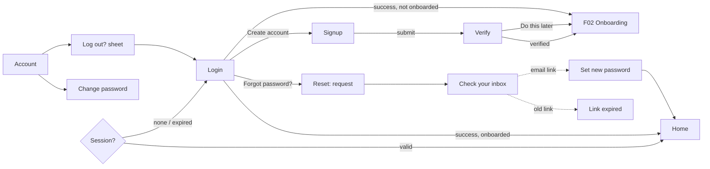

# F01 — Sign up, Log in, Password: UI design (LOCKED)

| | |
|---|---|
| **Status** | UI locked by Mudit, 2026-11-02 |
| **Spec IDs** | AUTH-001, AUTH-002, AUTH-003, AUTH-004, AUTH-005, ACCT-007, ACCT-008 |
| **Depends on** | F00 (app shell, theme from `docs/design/design-system.md`) |
| **Design source** | "FitSphere Screens" canvas in Claude: boards *F01 · Sign up* … *F01 · Log out* |
| **Put at** | `docs/features/F01-auth/ui-design.md`. `/feature-start F01` uses it as the approved UI input. |

All visual values come from `docs/design/design-system.md`. Copy in quotes is exact. UPPERCASE text is rendered by the style (Barlow Condensed uppercase); write it in sentence case in code.

---

## 1. Decisions taken in design (record in `spec.md` §18)

| Q | Decision |
|---|---|
| Q-02 password policy | At least 8 characters, at least one number and one letter, checked live. 5 failed logins → 5-minute lockout. Reset links work once and expire after 30 minutes. |
| Q-03 sign-in method | Email + password only for MVP. |
| Q-04 email verification | A **6-digit code** in the email (the email also contains a link). Users may tap **"Do this later"** and use the app unverified. Resend cooldown is 60 s. |
| DATE-003 wording | "Today is highlighted in **Caramel**" (was blue). |

---

## 2. Flow

---

## 3. Shared layout for auth screens (Sign up, Log in, Forgot, Verify)
- Background `bg`; padding 16 top, 20 sides, 28 bottom (plus safe areas).
- Signature stripe triangle in the top-right corner.
- Top bar, 44 high: back chevron on the left (where there is a back step), **FITSPHERE** wordmark centred.
- Heading block, 28–32 px below the top bar: optional step label ("STEP 1 OF 2", `accent`, Barlow Condensed 14/700, +2), then `display` heading over two lines with **the second line in `accent`**, then `body` sub-text in `inkMuted`.
- Fields stack with 18 px gaps.
- The primary button and the secondary link sit at the **bottom** (pushed down with `margin-top: auto`) and stay above the keyboard (KeyboardAvoidingView).
- Return key moves to the next field; on the last field it submits.

---

## 4. Screens

### 4.1 Sign up (AUTH-001)
**Top → bottom**
1. Back chevron (to the welcome/login screen) · wordmark
2. "STEP 1 OF 2"
3. Heading: "CREATE YOUR" / "ACCOUNT"
4. Sub: "Log your food, training and body metrics against your targets."
5. **Email** field (email keyboard, autocomplete email)
6. **Password** field with eye toggle → 3-segment strength bar → rule list:
   - "At least 8 characters"
   - "Includes a number"
   - "Includes a letter"
7. Checkbox 22×22 (radius 4; checked = `primary` fill with an Onyx tick): "I agree to the **Terms** and **Privacy Policy**" (links in `accent`)
8. Primary button "CREATE ACCOUNT →"
9. "Already have an account? **LOG IN**"

**States**
| State | What shows |
|---|---|
| empty | Button disabled (40 %); rules all muted |
| typing | Password border `accent`; met rules turn `success` with a tick, segments fill one per met rule; button disabled until all valid and the box is ticked |
| ready | Button enabled |
| submitting | Spinner in button; fields disabled |
| email can't be used | Email border `danger`; message under the field: "Can't use this email. **Log in** or **reset password**". It must not confirm that the account exists. |
| network error | Error banner above the button: "Couldn't reach FitSphere. Check your connection and try again." |

**Behaviour:** on success, create the account, record Terms acceptance with a timestamp, send the verification code, and go to Verify.

### 4.2 Log in (AUTH-002, AUTH-004)
**Top → bottom**
1. Wordmark (no back)
2. [session-expired banner, info variant] "You were signed out. Log in to pick up where you left off."
3. Heading: "WELCOME" / "BACK"
4. Sub: "Log in to see today's targets."
5. [error banner]
6. **Email**
7. **Password** label row with "FORGOT PASSWORD?" link on the right · field with eye
8. Primary "LOG IN →"
9. "New to FitSphere? **CREATE ACCOUNT**"

**States**
| State | What shows |
|---|---|
| ready | Default |
| loading | Spinner in button; fields 60 % opacity |
| wrong details | Error banner: "Email or password is incorrect. Check both and try again." (one generic message) |
| too many attempts | Error banner: "Too many attempts. Try again in 5 minutes, or reset your password."; button disabled |
| session expired | Info banner above the heading |

**Behaviour:** success → Home for today if onboarded, else Onboarding. The session is kept in secure storage.

### 4.3 Forgot password (AUTH-003): one screen, 4 steps
| Step | Heading | Content | Actions |
|---|---|---|---|
| request | "RESET YOUR" / "PASSWORD" | Sub: "Enter the email you signed up with. We'll send a reset link." Email field | "SEND RESET LINK →"; link "BACK TO LOG IN" |
| sent | "CHECK YOUR" / "INBOX" | 72 px mail icon tile (`accentTint`). "If an account exists for **{email}**, a reset link is on its way. It works once and expires in 30 minutes." · "Nothing yet? Check spam, or resend in **0:42**" | "OPEN EMAIL APP"; secondary "RESEND LINK" (disabled during the countdown) |
| new password (opened from the link) | "SET A NEW" / "PASSWORD" | Sub: "You'll be signed out on your other devices." New password + strength bar + "Strong password: 8+ characters, a number and a letter" · Confirm password | "SAVE AND LOG IN" |
| link expired | "LINK" / "EXPIRED" | Clock icon tile. "Reset links work once and only for 30 minutes. Request a new one and use it straight away." | "SEND A NEW LINK" |

**Rules:** the sent step shows the same text whether or not the email exists. After a successful reset, sign out all other sessions and log in here.

### 4.4 Verify your email (AUTH-005)
**Top → bottom:** back · wordmark → "STEP 1 OF 2" → "VERIFY YOUR" / "EMAIL" → "Enter the 6-digit code we sent to **{email}**. **Change**" → 6 code boxes → [error] → "Didn't get it? Resend in **0:42** · or tap the link in the email" → primary "VERIFY →" → link "DO THIS LATER" (`inkMuted`).

| State | What shows |
|---|---|
| typing | Filled digits; the next box has an `accent` border; button disabled until 6 digits |
| wrong code | All boxes `danger`; "That code didn't match. Check the latest email and try again." |
| verified | 80 px `success` tile with tick, "YOU'RE" / "IN", "Email verified. Next, a 1-minute setup: your name, units and starting weight.", primary "SET UP MY PROFILE →" → F02 |

Paste of a 6-digit code fills all boxes; auto-submit on the 6th digit. "Change" returns to Sign up with the email field filled in.

### 4.5 Change password (ACCT-007), pushed from Account
**Top → bottom:** back chevron + "ACCOUNT" (muted) → "CHANGE PASSWORD" (`screenTitle`) → "You'll stay signed in here. Other devices will be signed out." → [success banner] → **Current password** → **New password** + strength → **Confirm new password** → primary "UPDATE PASSWORD" → link "FORGOT CURRENT PASSWORD?" (→ Forgot password).

| State | What shows |
|---|---|
| ready | Default; button enabled when all three are valid and the new passwords match |
| wrong current | Current field `danger` + "Current password is incorrect." |
| mismatch | Confirm field `danger` + "Passwords don't match." |
| updated | Success banner: "Password updated. Other devices are signed out."; fields cleared |

### 4.6 Log out (ACCT-008): bottom sheet over Account
Account's Security group: "Change password", "Log out" (`accent`, bold), "Delete account" (`danger`, F16).
**Sheet:** grab handle → 56 px tile with log-out icon → "LOG OUT?" → "Your logs are saved to your account. You'll need your email and password to log back in." → primary "LOG OUT" → secondary "STAY LOGGED IN". Tapping the scrim or swiping down cancels.
**Behaviour:** end the session on the server, clear tokens and cached personal data, go to Log in.

---

## 5. Accessibility
- Every input has a visible label tied to it; the eye button is labelled "Show password" / "Hide password".
- Errors are announced (`accessibilityLiveRegion="polite"` / role alert) and placed next to the cause.
- Code boxes are announced as one field: "Verification code, 3 of 6 digits entered".
- Contrast is AA in both themes. Disabled buttons use `accessibilityState={{ disabled: true }}`.
- Text scales; headings wrap rather than truncate.

## 6. Implementation notes (Expo + Supabase, per ADR-0002)
- Sign up: `supabase.auth.signUp({ email, password })` with email confirmation on. Set the Supabase email template to send a **6-digit OTP**, plus the link.
- Verify: `supabase.auth.verifyOtp({ email, token, type: 'signup' })`; resend with `supabase.auth.resend({ type: 'signup', email })`.
- Log in: `signInWithPassword`. Map every credentials error to the one generic message. Lockout comes from the auth rate limits, plus a client-side message on the 429 response.
- Forgot: `resetPasswordForEmail(email, { redirectTo: <app deep link> })`. The deep link opens the "new password" step, which calls `updateUser({ password })`, then `signOut({ scope: 'others' })`.
- Change password: re-check the current password (re-authenticate), then `updateUser`, then `signOut({ scope: 'others' })`.
- Log out: `signOut()` and clear the query cache and any local personal data.
- Session storage: `expo-secure-store` adapter for the Supabase client.
- "Open email app": `Linking` to the default mail app, falling back to nothing.
- Password policy is checked in the app **and** set in Supabase Auth settings (minimum length, character requirements).

## 7. Demo script (60 s)
1. Open the app → Log in → "Create account".
2. Sign up with a new email: watch the rules turn green, tick Terms, create.
3. Enter the 6-digit code → "You're in" → (onboarding stub).
4. Account → Log out → confirm → back at Log in.
5. Log in with a wrong password → generic error; then the right one → Home.
6. Account → Change password → updated banner.
7. Log out → "Forgot password?" → request → check inbox.

## 8. Out of scope for F01
Phone OTP, Google/Apple sign-in, delete account (F16), onboarding screens (F02).
