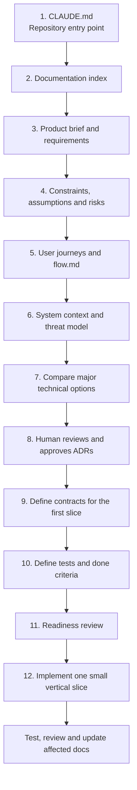
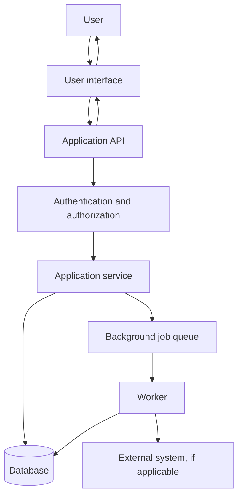
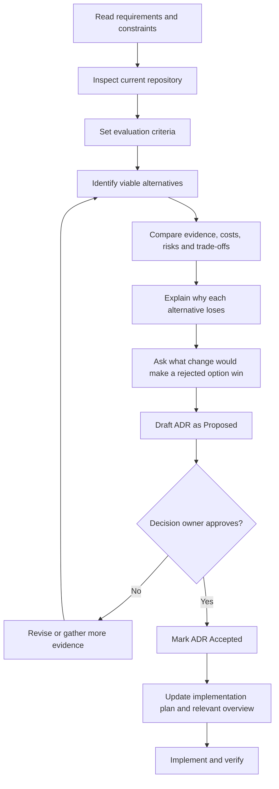

# Claude Code Pre-Development Guide

**Purpose:** A reusable guide for preparing any software repository for development with Claude Code. It explains which documents to create, in what order, how to record technical decisions, and how to verify work.

**Status:** Starter template. Adapt it to the actual project. Examples and recommendations in this guide are not automatically approved project decisions or Anthropic requirements.

---

## 1. The core principle

Use documentation for different jobs instead of repeating the same information in several files:

- **Requirements** describe what the product must do.
- **Constraints** describe the boundaries and non-negotiable conditions.
- **Flows and diagrams** show how people and systems interact.
- **ADRs** preserve why a major technical decision was made.
- **Contracts** define how components communicate and what data they exchange.
- **`CLAUDE.md` and rules** guide Claude Code while it works.
- **Skills** describe repeatable workflows.
- **Tests, hooks and CI** check behavior in a repeatable way.

A document should have one clear owner-purpose. If two documents would contain the same facts, keep the authoritative detail in one place and link to it from the other.

## 2. Which file should be created first?

Create a **minimal root `CLAUDE.md` first** so Claude Code knows how to work in the repository and where authoritative information belongs. Then create the product and design documents it points to. Update the links as those files are added.

### Recommended creation order

| Order | File | Main purpose |
|---:|---|---|
| 1 | `CLAUDE.md` | Short entry point: project purpose, working rules, and links to sources of truth |
| 2 | `docs/README.md` | Documentation index, status definitions, owners, and links |
| 3 | `docs/product/product-brief.md` | Problem, target users, goals, scope, and non-goals |
| 4 | `docs/product/requirements.md` | Stable, testable requirements and acceptance criteria |
| 5 | `docs/architecture/constraints-and-assumptions.md` | Hard constraints, assumptions, unknowns, risks, and owners |
| 6 | `docs/product/user-journeys.md` and `flow.md` | User journeys and high-level data/system flows |
| 7 | `docs/architecture/system-context.md` | System boundary, external systems, components, and trust boundaries |
| 8 | `docs/security/data-and-threat-model.md` | Data categories, sensitive flows, threats, and proposed controls |
| 9 | `docs/architecture/decisions/ADR-0001-*.md` | One ADR for each major decision that needs approval |
| 10 | `docs/contracts/` | Data, API, error, and integration contracts needed for the first implementation slice |
| 11 | `docs/quality/test-strategy.md` and `definition-of-done.md` | Verification approach and completion criteria |
| 12 | `docs/operations/runbook.md` | Setup, deployment, monitoring, recovery, and incident procedures |
| 13 | Feature-specific specifications and tasks | Small, reviewable implementation work with acceptance criteria |

This is a default sequence, not a requirement to complete every document before any code is written. Keep early drafts short. Documents needed for a feature should be ready before that feature is implemented; operational details can be completed in stages, before they are needed.

### Creation-order diagram



## 3. Suggested repository structure

Create only files that have a useful purpose. This is a suggested structure, not a mandatory Claude Code layout.

```text
repository/
├── README.md
├── CLAUDE.md
├── flow.md
├── .claude/
│   ├── rules/
│   │   ├── project-invariants.md
│   │   ├── security-and-privacy.md
│   │   ├── backend.md
│   │   ├── frontend.md
│   │   ├── database.md
│   │   └── testing.md
│   ├── skills/
│   │   ├── architecture-compare/SKILL.md
│   │   ├── feature-planning/SKILL.md
│   │   └── security-review/SKILL.md
│   └── settings.json                 # Optional; review before use
└── docs/
    ├── README.md
    ├── product/
    │   ├── product-brief.md
    │   ├── requirements.md
    │   └── user-journeys.md
    ├── architecture/
    │   ├── constraints-and-assumptions.md
    │   ├── system-context.md
    │   ├── architecture-overview.md
    │   └── decisions/
    │       ├── README.md
    │       └── ADR-0001-example-decision.md
    ├── security/
    │   └── data-and-threat-model.md
    ├── contracts/
    │   ├── data-model.md
    │   ├── api-conventions.md
    │   ├── error-model.md
    │   └── integrations.md
    ├── quality/
    │   ├── test-strategy.md
    │   └── definition-of-done.md
    └── operations/
        └── runbook.md
```

### Avoid documentation sprawl

- Do not create a generic `architecture.md` if it merely repeats the system context, architecture overview, constraints, and ADRs.
- Keep the current architecture summary short; put historical reasoning in ADRs.
- Do not copy the same requirement into the product brief, flow, API contract, and `CLAUDE.md`. Link to its authoritative source instead.
- Do not create every optional rule or skill on day one. Add one when there is a real need.
- Keep `CLAUDE.md` concise; a practical target is under 200 lines.

## 4. What each document owns

| Document | Owns | Should not duplicate |
|---|---|---|
| `README.md` | Human-facing project introduction, setup links, current status | Detailed design reasoning |
| `CLAUDE.md` | Instructions Claude Code should generally follow and links to source documents | Full requirements, long policies, ADR history |
| `docs/README.md` | Documentation index, status, owners | The documents' full contents |
| `product-brief.md` | Problem, users, goals, scope, non-goals | Detailed technical choices |
| `requirements.md` | Testable functional and non-functional requirements | Implementation design |
| `constraints-and-assumptions.md` | Hard limits, assumptions, unknowns, owners | The final rationale for a selected option |
| `user-journeys.md` | Actors, steps, alternate paths, expected outcomes | API schemas |
| `flow.md` | High-level user/system/data flow diagrams | Full requirement descriptions |
| `system-context.md` | System boundary, actors, external dependencies, trust boundaries | Detailed ADR comparisons |
| `architecture-overview.md` | Current components and responsibilities | Full historical decision records |
| ADRs | Context, options, selected decision, consequences, rejected options, revisit conditions | General project instructions |
| Contracts | Exact API/data/integration expectations | Product marketing or historical reasoning |
| Threat model | Assets, actors, trust boundaries, abuse cases, mitigations | Generic security slogans without project context |
| Test strategy | Test levels, coverage priorities, verification approach | Feature-specific acceptance criteria themselves |
| Runbook | Operational steps and recovery guidance | Architecture rationale |
| `.claude/rules/` | Focused implementation rules | Whole documentation pages |
| `.claude/skills/` | Repeatable multi-step procedures | Always-on instructions |

## 5. Starter templates

### 5.1 `CLAUDE.md`

```markdown
# Project Instructions for Claude Code

## Purpose
[One or two sentences describing the project.]

## Sources of truth
- Product scope and requirements: `docs/product/`
- Constraints and assumptions: `docs/architecture/constraints-and-assumptions.md`
- System flows: `flow.md`
- Accepted decisions: `docs/architecture/decisions/`
- Security model: `docs/security/`
- Contracts: `docs/contracts/`
- Verification: `docs/quality/`

If a referenced document does not exist, state that it is missing; do not invent its contents.

## Working rules
1. Inspect the actual repository before proposing changes.
2. Read relevant requirements, rules, contracts, and accepted ADRs before implementation.
3. Do not invent requirements, provider capabilities, benchmark results, or security guarantees.
4. For major choices, compare options against documented constraints and obtain human approval.
5. Do not silently change an Accepted ADR; propose a replacement ADR.
6. Protect secrets and sensitive data in code, logs, tests, examples, and output.
7. Add or update tests for behavior changes.
8. Run relevant checks and report exactly what passed, failed, or was not run.
9. Update the authoritative document when a requirement, contract, or accepted decision changes.
10. Prefer small, reviewable changes.

## Before coding
For non-trivial work, inspect first, prepare a plan, identify risks and tests, and wait for approval when required by the team's workflow.
```

### 5.2 `docs/product/product-brief.md`

```markdown
# Product Brief

- Status: Draft
- Owner: [role]
- Last updated: YYYY-MM-DD

## Problem
What problem are we solving, and what evidence shows it matters?

## Target users
Who will use or be affected by the product?

## Goals
What outcomes should the product achieve?

## Scope
What is included in the first release?

## Non-goals
What is explicitly excluded?

## Success measures
How will success be measured, and who owns each measure?

## Assumptions and open questions
List uncertain points, owners, and target dates for resolution.
```

### 5.3 `docs/product/requirements.md`

Use stable IDs and make requirements testable.

```markdown
## REQ-001 — [Requirement title]
- Type: Functional | Security | Privacy | Performance | Operational
- Priority: Must | Should | Could | Won't for this release
- Status: Draft | In Review | Accepted
- Owner: [role]
- Requirement: [one clear, testable statement]
- Rationale: [why it matters]
- Acceptance criteria:
  - Given [context], when [action], then [observable outcome].
- Dependencies: [other requirement, ADR, or contract IDs]
- Related tests: [test IDs or planned tests]
```

Avoid vague words such as “fast,” “secure,” and “scalable” unless the team defines a measure or review method.

### 5.4 `docs/architecture/constraints-and-assumptions.md`

```markdown
# Constraints and Assumptions

## Hard constraints
- C-001: [constraint, source, and reason]

## Quality targets
- Performance: [target or Open]
- Availability/reliability: [target or Open]
- Security/privacy: [requirement or Open]
- Accessibility: [target or Open]
- Budget/licensing: [limit or Open]
- Deployment/network/region: [requirement or Open]

## Assumptions
- A-001: [assumption, evidence, confidence, owner]

## Open questions
- Q-001: [question, impact, owner, due date]

## Revisit triggers
Which change would require the architecture to be reviewed again?
```

Keep assumptions visibly separate from confirmed requirements. Do not treat an aspiration or unverified scale estimate as a proven capacity target.

### 5.5 `flow.md`

Use this file for high-level diagrams that help someone understand the system. Start with the main user journey and the main system/data flow. Keep detailed endpoint schemas in contracts.

```markdown
# Product and System Flows

## Main user journey
[Describe the happy path and important alternate/failure paths.]

## System/data flow
[Show the main components, data direction, trust boundaries, and failure paths.]

## Open questions
[List unresolved flow decisions and link to their requirement or ADR IDs.]
```

Example generic flow:



Replace the example with the actual system; do not assume every project needs a worker or external integration.

### 5.6 ADR index and ADR template

Keep one short index at `docs/architecture/decisions/README.md`, linking to individual records. Number records consistently. Accepted ADRs are historical records: do not silently rewrite them when a decision changes.

Suggested statuses: **Proposed**, **Accepted**, **Rejected**, **Superseded**.

```markdown
# ADR-0001: [Decision title]

- Status: Proposed
- Date: YYYY-MM-DD
- Decision owner: [role]
- Related requirements: [IDs]
- Related constraints: [IDs]
- Supersedes: None

## Context
What problem are we solving? What is known and uncertain?

## Decision criteria
List hard constraints and evaluation criteria.

## Options considered
### Option A — [name]
- Benefits:
- Costs and risks:
- Fit against constraints:
- Evidence and uncertainty:

### Option B — [name]
- Benefits:
- Costs and risks:
- Fit against constraints:
- Evidence and uncertainty:

## Decision
State the selected option only after approval. Until then, write “Pending approval.”

## Why this option wins
Tie the decision to constraints and evidence, not popularity alone.

## Why alternatives were rejected
Explain the specific limitation, risk, cost, or trade-off for each rejected option.

## Counterfactual
What change would make a rejected option the better choice?

## Consequences and accepted trade-offs
What becomes easier, harder, more expensive, or riskier?

## Validation plan
What prototype, test, documentation check, or operational evidence is needed?

## Revisit conditions
What measurable change would trigger another review?

## References
Link to reliable evidence and relevant project documents.
```

Not every library needs an ADR. Use ADRs for consequential decisions that are expensive to reverse, materially affect security/cost/licensing, or shape the system architecture.

### 5.7 Contracts

Create only the contracts needed for the current implementation slice.

- `data-model.md`: entities, ownership, relationships, sensitive fields, retention, deletion, and integrity rules.
- `api-conventions.md`: authentication expectations, naming, validation, pagination, versioning, and response conventions.
- `error-model.md`: stable error shape, error codes, retryability, and safe user-facing messages.
- `integrations.md`: external system permissions, data exchanged, limits, timeouts, retries, revocation, and failure behavior.

Keep detailed schemas in the relevant contract rather than copying them into `CLAUDE.md`, `flow.md`, and the architecture overview.

### 5.8 `docs/security/data-and-threat-model.md`

```markdown
# Data and Threat Model

## Assets and data categories
What data exists, how sensitive it is, and why it is needed.

## Actors and trust boundaries
Users, administrators, services, workers, vendors, and other relevant actors.

## Data flows
Link to `flow.md`; document sensitive crossings and storage locations.

## Threat scenarios
For each scenario: asset, attacker/action, impact, likelihood, proposed mitigation, owner.

## Security controls
Authentication, authorization, isolation, encryption, secrets, logging, monitoring, and recovery as applicable.

## Retention and deletion
What is retained, for how long, how deletion works, and how completion is verified.

## Open risks
Unresolved risks, compensating controls, owners, and due dates.
```

Do not claim that the system is secure or compliant merely because this file exists. Controls need implementation and verification.

### 5.9 `docs/quality/test-strategy.md` and `definition-of-done.md`

The test strategy should define test levels, test data rules, important negative cases, and which checks run locally and in CI. The definition of done should be a concise checklist for every change, such as acceptance criteria, relevant tests, type/lint/build checks, documentation updates, and remaining risks.

### 5.10 `docs/operations/runbook.md`

Document only verified operational steps. Include local setup, required configuration names (not secret values), deployment and rollback, monitoring, backup/recovery, common failures, incident escalation, and the owner for each critical procedure. Mark unknown procedures as open rather than inventing commands.

## 6. How to make a technical decision before coding

Use this process for consequential choices such as language/runtime, major frameworks, storage, authentication, deployment, or licensing.



For each major choice:
1. State the problem and constraints before stating a preference.
2. Compare plausible alternatives; use three options only when three are genuinely viable.
3. Separate verified facts from assumptions and opinions.
4. Explain why rejected options do not fit the current constraints.
5. Ask the counterfactual question: what would have to change for a rejected option to win?
6. Have the designated human decision owner approve the decision.
7. Record the decision and consequences in an ADR before implementation.
8. If the decision later changes, create a new ADR and mark the old one Superseded.

## 7. Claude Code rules, skills and enforcement

### Rules: focused guidance

Use `.claude/rules/` for rules relevant to particular areas, such as security, backend, frontend, database, or testing. Keep each file focused. Use path-scoped rules only after checking the syntax supported by the installed Claude Code version.

### Skills: repeatable procedures

Use skills only for workflows that are likely to be repeated. Example skill folders:
- `.claude/skills/architecture-compare/SKILL.md`
- `.claude/skills/feature-planning/SKILL.md`
- `.claude/skills/security-review/SKILL.md`

A skill should say when it applies, what sources to inspect, the steps to perform, what output to produce, and when to stop for approval. Avoid creating a large skill library before the team has repeated workflows.

### Example: architecture comparison skill

```markdown
---
name: architecture-compare
description: Compare major technical options against documented constraints before implementation.
---

1. Read relevant requirements, constraints, risks, and existing ADRs.
2. Inspect the actual repository and current implementation.
3. Identify hard constraints and the decision owner.
4. Compare plausible options using current, reliable evidence.
5. State benefits, costs, risks, operational impact, security implications, and reversibility.
6. Explain why rejected options lose under the current constraints.
7. Describe what change would make each rejected option win.
8. Draft an ADR with status Proposed.
9. Stop for human approval before implementing the major decision.
```

### Hooks, permissions, tests and CI

Markdown instructions alone cannot guarantee behavior. Use tests, linters, type checks, CI, and narrowly scoped hooks where they provide reliable checks. Review permissions carefully; avoid broad permissions or bypass modes as a shortcut around review. Never make an automation silently approve an architecture decision.

Potential uses:
- Format or run lightweight checks after edits.
- Run shared lint, type-check, build, and test commands in CI.
- Block a clearly identified dangerous action where a reliable guard is possible.
- Remind the author to review contracts or ADRs after relevant changes.

Verify hook event names and configuration against current official documentation before relying on them.

## 8. Source quality and changing tools

When documenting a tool or framework:
1. Prefer current official documentation for supported features, commands, configuration, and security behavior.
2. Use engineering articles for implementation experience and trade-offs, checking important claims against primary sources.
3. Treat community posts and videos as leads to investigate, not authoritative proof.
4. Verify commands against the installed version; old transcripts may be stale.
5. Do not assume a command exists because it appears in a tutorial. Check the current help output and official docs.
6. Record links and dates for evidence that may become stale.

Claude Code-specific mechanisms—such as `CLAUDE.md`, rules, skills, hooks, permissions, and Plan Mode—should be checked against the current Anthropic documentation. The folder structure, ADR workflow, comparison criteria, and approval gates in this guide are project conventions, not mandatory Anthropic defaults.

Official starting point: [Claude Code documentation](https://code.claude.com/docs).

## 9. First review prompt for Claude Code

After adding the initial documents, run Claude Code from the repository root and request a read-only review before implementation:

```text
We are preparing this repository for development. Do not implement product features yet.

Read CLAUDE.md and the relevant documentation under docs/ and .claude/rules/.
Inspect the actual repository, scripts, dependencies, and configuration.
Do not assume a file, command, dependency, or architecture decision exists unless verified.

Return:
1. A summary of the documented product scope and requirements.
2. Conflicts, missing decisions, assumptions, and open questions.
3. Existing implementation choices versus proposed or accepted ADRs.
4. Major decisions that lack a constraint-based comparison, rejected alternatives,
   consequences, or revisit conditions.
5. Documentation gaps, prioritized by risk and dependency.
6. Security, privacy, operational, and testing gaps relevant to the documented scope.
7. A proposed next-step plan without editing files.

Separate verified facts from assumptions and recommendations.
Do not invent approval, mark decisions Accepted, or start coding.
```

Ask for specific missing documents or one ADR at a time after reviewing the report. Keep decisions Proposed until the decision owner approves them.

## 10. Readiness checklist

### Product and requirements
- [ ] Problem, target users, goals, scope, and non-goals are documented.
- [ ] Requirements have stable IDs and observable acceptance criteria.
- [ ] Success measures and open questions have owners.

### Architecture
- [ ] Constraints and assumptions are visible and distinguished.
- [ ] Existing repository state has been inspected.
- [ ] Major choices have evidence-based comparisons and approved ADRs.
- [ ] Rejected alternatives, consequences, and revisit conditions are recorded.
- [ ] System context and flows match the accepted design.

### Claude Code setup
- [ ] `CLAUDE.md` is concise and links to sources of truth.
- [ ] Rules are focused and skills are only used for repeatable workflows.
- [ ] Permissions, settings, and hooks have been reviewed.
- [ ] Commands and tool behavior have been verified against current documentation.

### Quality, security, and operations
- [ ] Relevant data, trust boundaries, and threat scenarios are documented.
- [ ] Contracts exist for the first implementation slice.
- [ ] Test strategy and definition of done are agreed.
- [ ] Setup and verification commands are confirmed.
- [ ] Required operational procedures and owners are identified.

### Implementation
- [ ] The first slice is small, testable, and tied to acceptance criteria.
- [ ] Relevant checks are actually run and their results reported.
- [ ] Documentation is updated when the authoritative requirements or contracts change.

**Gate rule:** Not every open question blocks every task. Assign an owner and assess impact. Explicitly mark whether an unresolved question blocks the affected feature; never silently turn uncertainty into a requirement.

## 11. A note on evidence and compliance

ADRs, documented constraints, and testable invariants can improve traceability and review. They do not, by themselves, prove that a system is secure, compliant, or correctly implemented. Claims need evidence from implemented controls, tests, operational records, and—where appropriate—independent review.

## 12. Final principle

**Claude Code should help execute the team's decisions, not silently become the decision owner.**

Use one authoritative location for each kind of information. Keep instructions short, decisions traceable, contracts precise, and enforcement testable. Start with a small, reviewed implementation slice and improve the documents when evidence or accepted decisions change.
