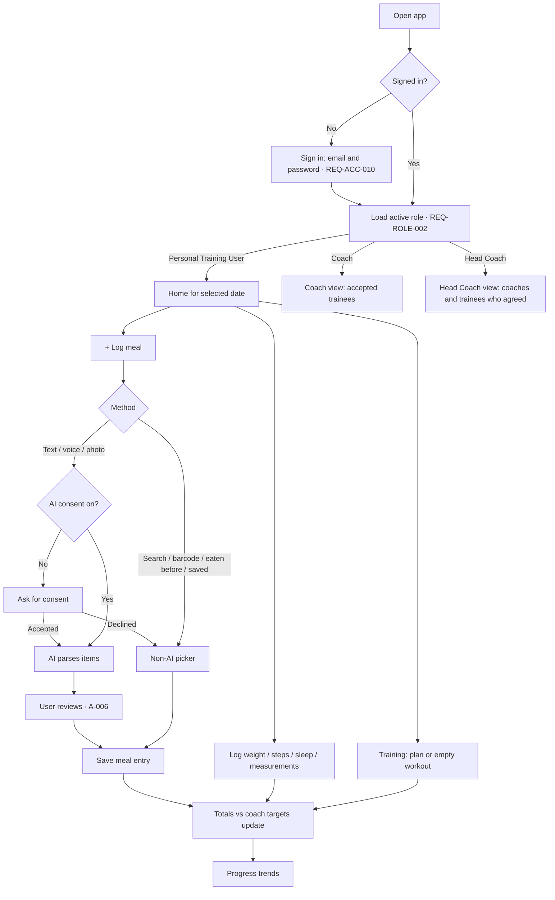
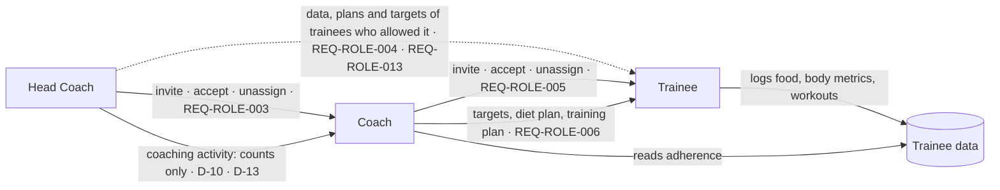
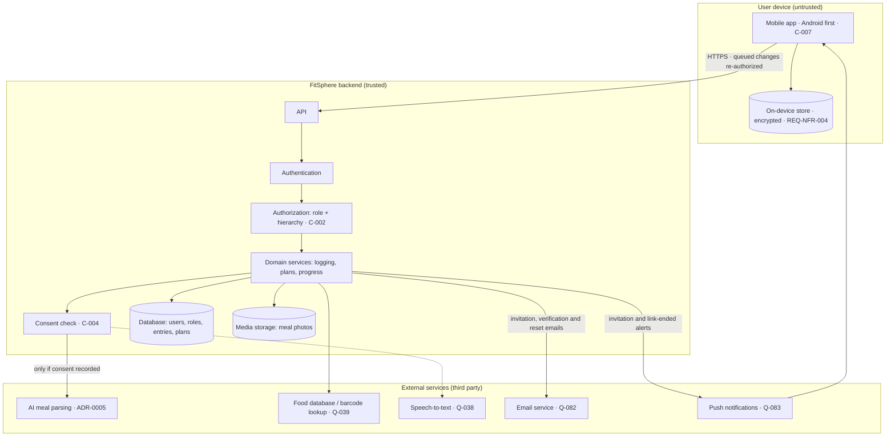

# Product and System Flows

- Status: Draft
- Owner: Project owner (D-01)
- Last updated: 2026-10-27

High-level only. Components below are **logical**. Only the mobile framework is chosen —
React Native with Expo (ADR-0001, Accepted, D-12); nothing else is (see
`docs/architecture/decisions/`). Detailed schemas will live in `docs/contracts/`.

## Main user journey (trainee daily loop)
See [`docs/product/user-journeys.md`](docs/product/user-journeys.md) J-01 to J-07.

## Coach / Head Coach flow

## System/data flow (logical)

Trust boundaries: device ↔ backend (all input untrusted; all authorization on backend);
backend ↔ each external service (sensitive meal data leaves our control — consent and data
processing terms required, Q-049). The full list of people, external systems and trust
boundaries is in [`docs/architecture/system-context.md`](docs/architecture/system-context.md).

Failure paths to design: AI/food-database timeout or error (keep user input, offer
alternatives); offline device (log on the device and sync later; every queued change is
re-authorized at sync — REQ-NFR-004, ADR-0007); consent withdrawn mid-request; a link that ends
(the former coach's or Head Coach's app deletes that trainee's data on its next sync — D-13); a
phone with no sync for 30 days (clear drafts and other people's data, keep the user's own
unsynced entries; the server stays the permanent record — D-14).

## Open questions affecting flows
Q-038, Q-039, Q-049, Q-075, Q-077, Q-082, Q-083 — see
[`docs/architecture/constraints-and-assumptions.md`](docs/architecture/constraints-and-assumptions.md).
