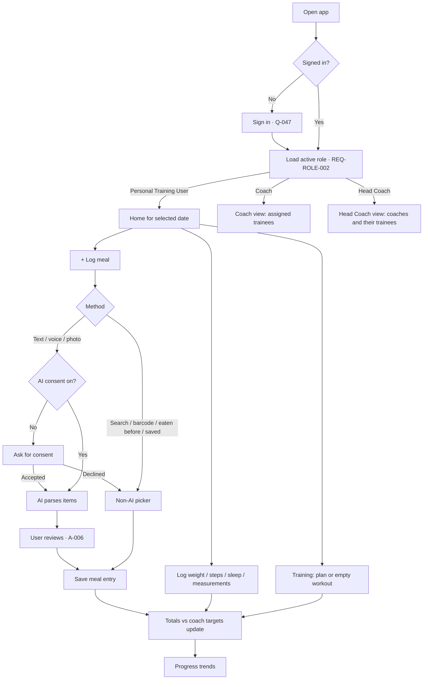
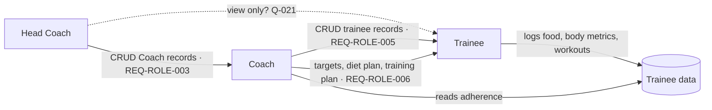
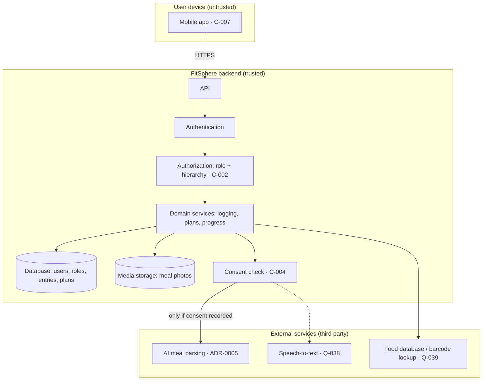

# Product and System Flows

- Status: Draft
- Owner: Tech lead (Q-001)
- Last updated: 2026-10-27

High-level only. Components below are **logical**; no technology is chosen (see
`docs/architecture/decisions/`). Detailed schemas will live in `docs/contracts/`.

## Main user journey (trainee daily loop)
See [`docs/product/user-journeys.md`](docs/product/user-journeys.md) J-01 to J-07.

## Coach / Head Coach flow

## System/data flow (logical)

Trust boundaries: device ↔ backend (all input untrusted; all authorization on backend);
backend ↔ each external service (sensitive meal data leaves our control — consent and data
processing terms required, Q-049).

Failure paths to design: AI/food-database timeout or error (keep user input, offer
alternatives); offline device (Open — offline logging not in BRD, Q-055); consent withdrawn mid-request.

## Open questions affecting flows
Q-006, Q-009, Q-021, Q-038, Q-039, Q-047, Q-049 — see
[`docs/architecture/constraints-and-assumptions.md`](docs/architecture/constraints-and-assumptions.md).
